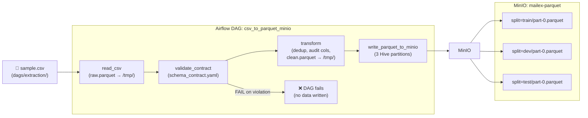

# DHAP-42 — Local CSV → MinIO Parquet Ingestion Pipeline

> **Intern project** — Springer Capital Data Engineering  
> Dataset: MailEx Email-Event-Extraction (EMNLP 2023)  
> Predecessor: [DHAP-34](../Email_Event_Extraction/email-event-extraction/) — CSV → PostgreSQL via Dockerized Airflow

---

## Overview

This project implements a production-quality data ingestion pipeline that reads
a curated CSV of email-event annotations, enforces a strict schema contract,
transforms the data, and writes Snappy-compressed Parquet files to a MinIO
(S3-compatible) object store — all orchestrated by Apache Airflow running in Docker.

### Architecture

```
┌─────────────────────────────────────────────────────────────────────┐
│                        Docker Compose Stack                          │
│                                                                      │
│  ┌──────────────┐        ┌────────────────────────────────────────┐ │
│  │ postgres-meta│        │         Airflow (LocalExecutor)         │ │
│  │  (metadata)  │◄──────►│                                        │ │
│  └──────────────┘        │  DAG: csv_to_parquet_minio             │ │
│                          │                                        │ │
│                          │  read_csv                              │ │
│                          │     ↓                                  │ │
│                          │  validate_contract ── FAIL here        │ │
│                          │     ↓            on any violation      │ │
│                          │  transform                             │ │
│                          │     ↓                                  │ │
│                          │  write_parquet_to_minio                │ │
│                          └──────────────┬─────────────────────────┘ │
│                                         │ boto3 (S3 API)            │
│  ┌──────────────────────────────────────▼─────────────────────────┐ │
│  │                         MinIO                                   │ │
│  │  API  :9000 (internal) / :9020 (host)                          │ │
│  │  UI   :9001 (internal) / :9021 (host)                          │ │
│  │                                                                 │ │
│  │  mailex-parquet/                                                │ │
│  │    email_event_extraction/                                      │ │
│  │      split=train/part-0.parquet   (7,199 rows after dedup)     │ │
│  │      split=dev/part-0.parquet     (1,015 rows after dedup)     │ │
│  │      split=test/part-0.parquet    (  945 rows after dedup)     │ │
│  └─────────────────────────────────────────────────────────────────┘ │
│                                                                      │
│  ┌──────────────┐                                                    │
│  │   mc-init    │  (one-shot: creates bucket on startup, idempotent) │
│  └──────────────┘                                                    │
└─────────────────────────────────────────────────────────────────────┘
```

### Mermaid Diagram



---

## Relationship to DHAP-34

| Aspect | DHAP-34 | DHAP-42 |
|--------|---------|---------|
| Target | PostgreSQL (warehouse) | MinIO (object store) |
| Format | SQL rows | Parquet (partitioned) |
| Ports | Airflow :8080 | Airflow :8082 |
| Validation | Missing col + nullable + int type | Full schema contract (12 checks) |
| Transport | XCom JSON string | Temp Parquet file in /tmp/ |
| Idempotency | TRUNCATE + INSERT | Delete prefix then write |
| Connection | AIRFLOW_CONN_POSTGRES_TARGET | AIRFLOW_CONN_MINIO_S3 |

Both stacks can run **simultaneously** with no port conflicts.

---

## Prerequisites

- **Docker Desktop** (or Docker Engine + Compose plugin) — v24+
- **Python 3.9+** on the host (only for running `tests/generate_fixtures.py` and `tests/run_negative_tests.py` outside Docker)
- `pandas` and `boto3` installed on the host for the test scripts: `pip install pandas boto3`

---

## Setup

### 1. Copy the environment file

```bash
cp .env.example .env
```

The default values in `.env.example` work **out of the box** for local development.  
You only need to change them if you want different credentials or ports.

### 2. Start Docker Desktop

Make sure the Docker daemon is running.

### 3. Bring up the stack

```bash
docker compose up -d
```

This will:
1. Build the custom Airflow image (adds pandas, pyarrow, PyYAML, boto3)
2. Build the MinIO image (downloads the server binary from GitHub Releases)
3. Start PostgreSQL (Airflow metadata)
4. Start MinIO (S3 API on :9020, web console on :9021)
5. Run `mc-init` to create the `mailex-parquet` bucket via boto3 (idempotent)
6. Run `airflow-init` to migrate the DB and create the admin user
7. Start the Airflow webserver and scheduler

**First build takes ~5–10 minutes** (pulling images + pip install).

### 4. Wait for healthy

```bash
docker compose ps        # wait until all services are (healthy)
```

Or watch logs:
```bash
docker compose logs -f airflow-webserver
```

---

## URLs and Default Logins

| Service | URL | Username | Password |
|---------|-----|----------|----------|
| Airflow UI | http://localhost:8082 | admin | admin |
| MinIO console | http://localhost:9021 | minioadmin | minioadmin123 |

> **Note**: If you changed `AIRFLOW_WEBSERVER_PORT`, `MINIO_CONSOLE_PORT` in `.env`, use those ports instead.

---

## How to Trigger the DAG

### Via Airflow UI
1. Open http://localhost:8082
2. Log in with admin / admin
3. Find `csv_to_parquet_minio` in the DAG list
4. Click the **▶ Trigger DAG** button
5. Optionally override params (csv_path, contract_path) in the JSON conf

### Via Airflow CLI (inside the container)
```bash
# Good CSV (default)
docker exec dhap42_airflow_scheduler \
  airflow dags trigger csv_to_parquet_minio

# Override CSV path (for negative tests)
docker exec dhap42_airflow_scheduler \
  airflow dags trigger csv_to_parquet_minio \
  --conf '{"csv_path":"/opt/airflow/tests/bad_missing_column.csv"}'

# Unpause if needed
docker exec dhap42_airflow_scheduler \
  airflow dags unpause csv_to_parquet_minio
```

### Via REST API
```bash
curl -s -u admin:admin \
  -H "Content-Type: application/json" \
  -X POST http://localhost:8082/api/v1/dags/csv_to_parquet_minio/dagRuns \
  -d '{"conf": {}}'
```

---

## How to Run the Negative Tests

### Step 1 — Generate fixtures (run once, on the host)
```bash
python tests/generate_fixtures.py
```

This creates `tests/bad_missing_column.csv` and `tests/fixtures/b_*.csv` through `i_*.csv`.

### Step 2 — Run the test suite
```bash
python tests/run_negative_tests.py
```

Expected output:
```
[a] ✓ PASS  Missing event_type + bad num_arguments
[b] ✓ PASS  Renamed column
[c] ✓ PASS  Extra column
[d] ✓ PASS  Wrong dtype in num_arguments
[e] ✓ PASS  Null in non-nullable thread_file
[f] ✓ PASS  Invalid event_type value
[g] ✓ PASS  Invalid split value
[h] ✓ PASS  Malformed trigger_indices
[i] ✓ PASS  Empty file / header only

9/9 tests passed.
```

Each test asserts:
- DAG run **state = failed**
- `validate_contract` task **state = failed**
- `transform` and `write_parquet_to_minio` show **upstream_failed**
- MinIO object count **has not increased**

---

## Schema Contract

The contract is defined in `schema_contract.yaml` (mounted into Airflow at `/opt/airflow/config/`).

### Enforced Rules

| Rule | Behaviour on Violation |
|------|----------------------|
| Missing column | FAIL |
| Renamed column | FAIL (detected as missing + extra) |
| Extra column | FAIL (`allow_extra_columns: false`) |
| Wrong column order | FAIL (`enforce_column_order: true`) |
| Wrong type (e.g. string in int column) | FAIL (strict, no coercion) |
| Null in non-nullable column | FAIL |
| Value not in `allowed_values` | FAIL |
| Value not matching `regex` | FAIL |
| `num_arguments` < 0 | FAIL |
| `sentence_text` blank | FAIL |
| Duplicate `id` | FAIL |
| Empty file / header only | FAIL |

All violations are **collected** before raising — you see the full list in one error.

### Column Summary

| # | Column | Type | Nullable | Key Rules |
|---|--------|------|----------|-----------|
| 1 | id | integer | No | Unique |
| 2 | thread_file | string | No | Ends with `.json` |
| 3 | split | string | No | Allowed: train, dev, test |
| 4 | turn_id | string | No | Pattern: `^turn_\d+$` |
| 5 | event_type | string | No | 12 allowed values |
| 6 | trigger_text | string | **Yes** | — |
| 7 | trigger_indices | string | **Yes** | When present: `^\d+(\s\d+)*$` |
| 8 | extras | string | **Yes** | — |
| 9 | sentence_text | string | No | Non-empty |
| 10 | num_arguments | integer | No | >= 0 |

---

## Partitioning Rationale

The dataset is partitioned by **`split`** (train / dev / test).

**Why `split`?**
- Exactly **3 distinct values** → 3 Parquet files, manageable and predictable
- **No nulls** → Hive-style partitioning is safe
- **Reasonably balanced** (≈78% / 11% / 10%)
- Downstream ML workflows almost always filter by split first

**Why not `event_type`?**
- 12 values, heavily unbalanced ("O" = 789 rows, others range 85–1,600)
- Produces 12 small, uneven files with poor read efficiency

**Why not `thread_file`?**
- 1,500 distinct values → 1,500 tiny Parquet files (~6 rows each)
- Anti-pattern: hurts object-store list performance and query planning

---

## Folder Layout

```
project-DHAP-42-email-event-extraction/
│
├── Dockerfile                      # Airflow + pandas/pyarrow/PyYAML/boto3/moto
├── Dockerfile.minio                # Real MinIO server (GitHub Releases binary)
├── docker-compose.yaml             # All services
├── .env.example                    # Template (copy to .env)
├── .gitignore
├── manifest.yaml                   # Dataset metadata
├── README.md
│
├── config/
│   └── schema_contract.yaml        # Validation contract, mounted into Airflow
│
├── dags/
│   ├── csv_to_parquet_minio.py     # The pipeline DAG
│   └── extraction/
│       └── sample.csv              # The 9,168-row MailEx CSV
│
├── tests/
│   ├── bad_missing_column.csv      # Fixture (a): missing event_type + bad dtype
│   ├── generate_fixtures.py        # Generates fixtures b–i from good CSV
│   ├── run_negative_tests.py       # Runs all 9 negative tests
│   └── fixtures/
│       ├── b_renamed_column.csv
│       ├── c_extra_column.csv
│       ├── d_wrong_dtype.csv
│       ├── e_null_nonnullable.csv
│       ├── f_invalid_event_type.csv
│       ├── g_invalid_split.csv
│       ├── h_bad_trigger_indices.csv
│       └── i_empty_file.csv
│
└── docs/
    └── evidence/                   # Screenshots and log excerpts
```

---

## Assumptions

1. **Port defaults**: Airflow :8082, MinIO API :9020, MinIO console :9021 — chosen to avoid DHAP-34's :8080 and :5433. Change via `.env` if needed.
2. **`bad_missing_column.csv`** was not provided as a file — it is generated by `generate_fixtures.py`. The spec describes its content (missing `event_type`, bad `num_arguments`); this script faithfully produces it.
3. **Wrong column order** fails the DAG (`enforce_column_order: true`). This is the safer choice — a silently reordered schema could cause incorrect downstream partition values or type mismatches.
4. **Exact duplicate detection** ignores `id` (as specified) and keeps the first occurrence (lowest id).  The 9 known duplicates in the dataset are dropped.
5. **Audit columns** (`ingested_at`, `run_id`) are appended after validation so they never interfere with schema checks.
6. **Airflow version**: 2.9.3 (same as DHAP-34 for operational consistency).
7. **MinIO version**: resolved at build time by querying the GitHub Releases API for the latest release with binary assets and installing the amd64 DEB package (`dpkg -i`). The actual version baked into the image is printed in `docker compose build` output — `RELEASE.2025-09-07T16-13-09Z` at time of writing. No Docker Hub org-image pull required; only `debian:12-slim` (official library image) is needed.
8. **Temp files** live at `/tmp/dhap42_<run_id>/`. If a container is killed mid-run, these may persist; they are harmless and cleaned up on the next successful run.
9. **`AIRFLOW__CORE__FERNET_KEY`**: left blank in this local-dev setup. For production, generate with `python -c "from cryptography.fernet import Fernet; print(Fernet.generate_key().decode())"`.

---

## Troubleshooting

### Port already in use
```
Error: Bind for 0.0.0.0:8082 failed: port is already allocated
```
Change `AIRFLOW_WEBSERVER_PORT` (or `MINIO_API_PORT` / `MINIO_CONSOLE_PORT`) in `.env` and restart.

### Permission errors on Linux (volumes)
```bash
echo "AIRFLOW_UID=$(id -u)" >> .env
docker compose down && docker compose up -d
```

### MinIO bucket not created
Check `mc-init` logs:
```bash
docker compose logs mc-init
```
The `mc-init` container waits for MinIO health then creates the bucket. If it exited before MinIO was ready, restart it:
```bash
docker compose restart mc-init
```

### Airflow connection to MinIO not working
Verify the `AIRFLOW_CONN_MINIO_S3` value in `.env`. It must be:
```
aws://minioadmin:minioadmin123@/?endpoint_url=http%3A%2F%2Fminio%3A9000
```
The `minio` hostname resolves inside Docker Compose; from the host, use `localhost:9020`.

### DAG not appearing in Airflow UI
```bash
docker exec dhap42_airflow_scheduler airflow dags list
docker exec dhap42_airflow_scheduler airflow dags report
```
Check for import errors:
```bash
docker exec dhap42_airflow_scheduler airflow dags list-import-errors
```

### Re-running from scratch
```bash
docker compose down -v   # removes volumes (MinIO data + Airflow DB)
docker compose up -d
```

---

## Verification Checklist

- [ ] `docker compose ps` — all services healthy
- [ ] MinIO console :9021 — `mailex-parquet` bucket visible (empty)
- [ ] Trigger DAG → 4 green tasks → 3 parquet objects in MinIO
- [ ] Row count via `pyarrow.parquet.read_table()` = **9,159** (9,168 − 9 duplicates)
- [ ] Negative tests: `python tests/run_negative_tests.py` → 9/9 pass
- [ ] Re-trigger good CSV → same 3 objects, same row counts (idempotent)
